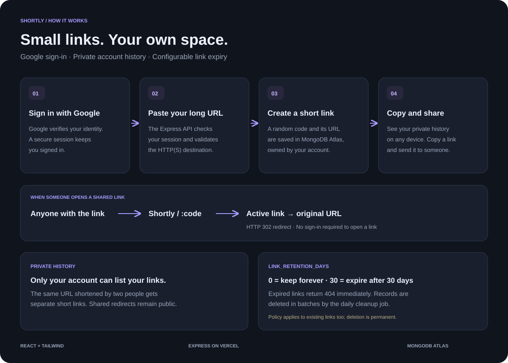

# Shortly · URL Shortener

An Express 5 + MongoDB URL shortener with a responsive React web frontend. Updated for 2026 with Node.js 22+, Mongoose 9, cryptographic short codes, HTTP(S) validation, security headers, request limits, and integration tests.

## How it works



Sign in with Google, paste a URL, and share your short link. Your account history is private; anyone with a shared short link can open its destination. Set `LINK_RETENTION_DAYS` to expire links after a chosen number of days (`0` disables expiry).

## Run locally

```sh
npm ci
cp .env.example .env
npm run dev
```

Open http://localhost:8080. The example environment uses **temporary in-memory storage**: links disappear on restart. Accounts, sessions, and links in memory disappear on restart. Google credentials are required to sign in locally. Use `npm run start:demo` for a quick preview without an environment file.

For persistent links, remove `STORAGE=memory` and set `DB_CONNECTION` to your MongoDB connection string. Existing `databases` collection records and short codes are retained. Back up your database before upgrading; resolve any duplicate `urlCode` values before enabling the unique index. Production explicitly rejects memory storage.

## Frontend

- Shorten links, open the result, and copy to clipboard (clipboard requires localhost or HTTPS).
- Private account history stored on the server, with individual copy actions.
- Responsive layout, keyboard focus states, live status and error messages.
- React components manage shortening, clipboard feedback, and recent history. Midnight is the sole theme.
- Frontend source lives in `frontend/`; `npm run build` compiles Tailwind CSS and bundles React with esbuild into `public/`. Frontend and API share an origin.
- `npm run dev` builds the frontend and watches the backend. Run `npm run dev:frontend` in a second terminal to rebuild React on edits. Startup and tests also build automatically.

## API

`POST /api/url/shorten` requires a session cookie and matching `Origin`, with JSON:

```json
{ "longUrl": "https://example.com/a/long/path" }
```

Returns the existing API fields: `longUrl`, `shortUrl`, `urlCode`, and `date`. Repeated normalized URLs reuse an existing active record for the signed-in account. Includes `expiresAt` (null when retention is disabled). Only HTTP/HTTPS destinations without embedded credentials are accepted. Invalid input returns 400; creation is limited to 30 requests per minute per IP (429). The default limiter is per server process; use a shared limiter store for multi-instance deployments.

`GET /:code` redirects with HTTP 302, or returns 404 for unknown/expired links. `GET /api/health` reports storage mode. Links are public bearer links: anyone with a short link can open its destination. `GET /api/links` lists only the authenticated account’s latest 100 active links.

## Environment

| Variable | Purpose |
| --- | --- |
| `PORT` | Local port, default 8080 |
| `BASE_URL` | Public origin used in short links; set your deployed HTTPS domain in production |
| `DB_CONNECTION` | MongoDB connection string (or use `MONGODB_URI` from the Atlas integration) |
| `STORAGE` | Set to `memory` only for local development |
| `NODE_ENV` | Set to `production` for production |
| `TRUST_PROXY` | Set to `1` only when behind exactly one trusted reverse proxy |

Legacy `host` is supported as a fallback for `BASE_URL`. Short URL origins come from configuration, not untrusted request headers.

## Vercel

Import the repository as a Node.js project. Set the Vercel Build Command to `npm run build`. `vercel.json` routes requests through the exported handler and includes the frontend assets. Add MongoDB Atlas through the Vercel Marketplace, or use an existing cluster. Configure `DB_CONNECTION` (or the integration’s `MONGODB_URI`), `BASE_URL`, `NODE_ENV=production`, and `TRUST_PROXY=1`; leave `STORAGE` unset. MongoDB must accept connections from the deployment. Database connections are reused within warm function instances. Configure Google sign-in and the cleanup secret as described below before redeploying this update.

## Verification

```sh
npm test
npm audit
```

Tests cover private account isolation, OAuth state/replay handling, logout, session expiry, origin checks, link expiry/deletion, disabled retention, URL validation, redirects, and rate limiting using isolated memory storage. Live MongoDB and hosted deployment require separate environment verification.

## Google accounts and private history

Creating links and fetching `/api/links` now require Google sign-in. History is stored in MongoDB and scoped to Google's stable account ID (`sub`); the same URL shortened by two people gets different short codes. Session tokens are random, stored as SHA-256 hashes, and sent in HttpOnly, SameSite=Lax cookies (Secure with an HTTPS BASE_URL). Google OAuth uses the official Google library with state, nonce, PKCE, and ID-token verification. Sessions expire and logout revokes the current session. Google access/refresh tokens are not retained. State-changing API requests require the configured Origin.

Old anonymous browser history is discarded. Old database links keep working until expired but are not assigned to any user or exposed in account history. Shared short links remain public redirects; accounts protect link management/history, not access to a destination by someone who knows the short URL. The account list returns the latest 100 active links.

### Google configuration on Vercel

1. In Google Cloud Console, configure Google Auth Platform branding, audience and consent. While the app is in Testing, add permitted test users. Publish to allow the intended audience.
2. Create an OAuth client of type **Web application**.
3. Add the authorized redirect URI exactly: `https://url-shortener-api-beta.vercel.app/api/auth/google/callback`. Add `http://localhost:8080/api/auth/google/callback` for local testing if needed.
4. Set server-only `GOOGLE_CLIENT_ID` and `GOOGLE_CLIENT_SECRET` in Vercel. Keep `BASE_URL=https://url-shortener-api-beta.vercel.app`, `MONGODB_URI`, `NODE_ENV=production`, and `TRUST_PROXY=1`.
5. Optionally set `SESSION_MAX_AGE_DAYS` (integer 1–90, default 7).
6. Redeploy. No passwords or frontend client secrets are needed. Without Google credentials, the sign-in UI explains setup is pending and link creation remains locked.

### Configurable link retention

- `LINK_RETENTION_DAYS=0` (default): automatic expiry/deletion is disabled.
- `LINK_RETENTION_DAYS=30`: links stop redirecting 30 × 24 hours after creation. Re-shortening the same active URL does not reset its creation time.
- Integers from 0 through 36500 are supported; invalid settings prevent startup.
- The current policy applies to **all links, including existing anonymous links**. Reducing retention can permanently delete old links after redeployment. Increasing retention cannot recover already deleted links. Back up data before enabling/changing retention.
- Expiry is checked on each redirect. Expired links are removed when a signed-in user lists or creates links, and by the daily cleanup job. With no traffic, scheduled deletion occurs on the next cron run, not precisely at expiry.
- Set `CRON_SECRET` to a random value of at least 32 characters. `vercel.json` schedules `/api/cron/cleanup` daily at 03:00 UTC (04:00 Lagos). Vercel supplies the secret as a Bearer authorization header. Without the secret the endpoint rejects requests and scheduled cleanup will fail closed.
- Local servers do not schedule jobs; call the cleanup endpoint with `Authorization: Bearer <CRON_SECRET>` from your scheduler, or rely on cleanup during create/list requests.
- Legacy records use their original `date`; malformed/missing dates are preserved for manual inspection. Session records have a separate MongoDB TTL index; session expiration is also enforced at request time.

Tests use a fake Google provider and isolated memory storage; real Google login, MongoDB indexes, and the deployed cron require verification after configuring production credentials.
